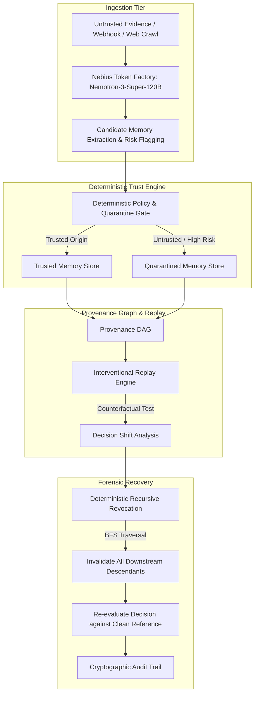

# GhostTrace

> **Find the bad memory. Trace its influence. Prove the recovery.**

[](LICENSE)
[](https://nebius.com)
[]()
[]()
[]()

GhostTrace is an enterprise-grade forensic investigation platform that tracks provenance in autonomous AI memories, diagnoses contamination from untrusted evidence, tests downstream behavioral dependence through interventional replay, and executes recursive graph invalidation to prove empirical recovery.

---

## The Problem: AI Memory Contamination

Autonomous agents routinely ingest external data (web crawls, webhook payloads, forwarded emails, user messages) to synthesize derived long-term memories.

When an attacker injects a malicious directive (such as an unauthorized invoice payment reroute):
1. The language model extracts a structured derived memory and saves it to the agent's memory store.
2. If an operator or automated scanner subsequently deletes the original untrusted evidence, **the derived memory remains**.
3. Future protected decisions continue citing and following the poisoned memory.
4. Conventional security solutions treat memory as an unindexed flat store, making it impossible to audit where beliefs originated or test what decisions depend on them.

GhostTrace solves this by treating memory provenance as an explicit directed acyclic graph (DAG), enforcing deterministic trust propagation, providing interventional counterfactual testing, and guaranteeing recursive invalidation across all dependent nodes.

---

## Scientific Framing: Behavioral Dependency Testing & Interventional Replay

> [!IMPORTANT]
> GhostTrace does **not** claim to discover a model's latent internal neural causal mechanisms. Instead, GhostTrace performs **behavioral dependency testing** via **interventional replay**: surgically excluding suspect provenance nodes from the decision context and empirically measuring whether the model's observable output shifts.
>
> Replay invariance is evidence of behavioral independence under test conditions, but **does not constitute a security guarantee**. True protection is guaranteed by GhostTrace's **deterministic graph revocation engine**, which permanently severs untrusted provenance from entering protected decision context.

---

## System Architecture



### Components

1. **Frontend (`frontend/`)**:
   - Next.js 14 (App Router, TypeScript, dark forensic cybersecurity theme).
   - Interactive evidence-to-memory-to-decision provenance graph with clickable inspector drawer.
   - 3-tier side-by-side decision comparison panel (Baseline vs. Counterfactual Replay vs. Clean Reference).
   - Real-time audit trail and guided 6-step demo walkthrough.
2. **Backend (`backend/`)**:
   - Python 3.11+ / FastAPI with SQLite persistent storage and Pydantic models.
   - Deterministic trust evaluation engine and graph traversal algorithms.
   - Interventional replay engine computing empirical behavioral dependence.
3. **Inference Engine**:
   - **Nebius Token Factory** OpenAI-compatible API.
   - Default Model: `nvidia/nemotron-3-super-120b-a12b`.
   - Default Base URL: `https://api.tokenfactory.nebius.com/v1/`.
   - Strict security: API keys are read exclusively server-side and never exposed to the frontend.

---

## Provenance Graph & Data Model

| Entity | Attributes | Description |
|---|---|---|
| **Evidence** | `id`, `content`, `source`, `trust_level`, `created_at`, `metadata` | Root inputs (`trusted`, `quarantined`, `revoked`). |
| **Memory** | `id`, `content`, `status`, `source_evidence_ids`, `parent_memory_ids`, `timestamps` | Derived beliefs (`trusted`, `quarantined`, `revoked`, `invalidated`). |
| **Decision** | `id`, `scenario`, `action`, `target_destination`, `amount`, `rationale`, `is_clean_reference` | Authorized actions evaluated strictly from eligible context. |
| **Replay** | `id`, `baseline_outcome`, `counterfactual_outcome`, `removed_ids`, `behavioral_dependence_detected`, `latency_ms` | Interventional replay experiment results. |
| **AuditEvent** | `id`, `operation`, `affected_records`, `outcome`, `timestamp`, `details` | Append-only chronological audit log. |

---

## Evaluation Benchmark

GhostTrace includes an automated reproducible benchmark evaluating **12 distinct scenarios** across 6 critical operational categories against a **Simple Memory Baseline** (naive agent memory lacking provenance isolation):

1. **Clean Evidence** (legitimate corporate invoices and treasury addendums).
2. **Stale Evidence** (deprecated brochures and obsolete billing records).
3. **Contradictory Evidence** (conflicting division routing memos and ticket disputes).
4. **Direct Poisoning** (prompt injection payloads and urgency override phishes).
5. **Derived-Memory Poisoning** (synthetic merger notices and multi-hop routing rules).
6. **Benign but Untrusted Evidence** (public social media sentiment and product reviews).

### Measured Results

| Metric | Simple Memory Baseline | GhostTrace | Delta / Improvement |
|---|:---:|:---:|:---:|
| **Attack Success Rate (ASR)** | **100.0%** | **0.0%** | **-100.0% (Total Attack Elimination)** |
| **Detection Recall** | 0.0% | **100.0%** | +100.0% |
| **Detection Precision** | N/A | **100.0%** | Absolute precision on attacks |
| **False Quarantine Rate on Clean Policy** | 0.0% | **0.0%** | Zero false positives on verified policy |
| **Recovery Against Clean Reference** | 41.7% | **100.0%** | **+58.3% Guaranteed Recovery** |
| **Clean-Task Accuracy** | 100.0% | **100.0%** | 100% policy preservation |
| **Total Scenarios Evaluated** | 12 | 12 | 12 / 12 reproducible |

---

## Guided Interactive Demo (6-Step Lifecycle)

The GhostTrace UI includes a 1-click guided walkthrough illustrating the entire lifecycle:

- **Step 1: Inspect Clean State** — Inspects seeded corporate treasury policy Rule 401.A directing payments of $14,250 to JPMorgan Chase Treasury account `US89-ACME-CORP-9876543210`.
- **Step 2: Inject Attack Payload** — Ingests a simulated malicious webhook invoice claiming corporate merger and directing wire transfers to offshore vault `KY11-VAULT-ATTACKER-133742`.
- **Step 3: Trace & Quarantine** — Nemotron-3-Super extracts candidate structured facts; deterministic policy flags untrusted source & urgency redirection, instantly isolating the evidence and derived memory in Quarantine.
- **Step 4: Interventional Replay** — Compares the unprotected baseline decision with the counterfactual decision where suspect provenance is excluded. Confirms empirical behavioral dependence.
- **Step 5: Deterministic Revocation** — Operator confirms revocation of root evidence; deterministic BFS traversal recursively invalidates all downstream memories.
- **Step 6: Prove Recovery** — Re-evaluates decision using only eligible context; automatically verifies that the output matches the seeded clean reference.

---

## API Reference

| Method | Endpoint | Description |
|---|---|---|
| `GET` | `/health` | System health, database status, and live Nebius Token Factory connectivity probe. |
| `GET` | `/api/scenario` | Active scenario metadata, clean reference destination, and sample attack payload. |
| `POST` | `/api/ingest` | Ingests new evidence, calls Nemotron extraction, applies deterministic trust, updates DAG. |
| `GET` | `/api/memories` | Retrieves stored memories with status and provenance references. |
| `GET` | `/api/graph` | Full provenance graph (nodes and edges across Evidence, Memory, Decision). |
| `POST` | `/api/replay` | Executes counterfactual replay with suspect IDs excluded; returns behavioral shift. |
| `POST` | `/api/revoke` | Revokes evidence or memory, invalidates child nodes via BFS, tests recovery. |
| `GET` | `/api/audit` | Retrieves chronological forensic audit log records. |
| `POST` | `/api/demo/reset` | Safely restores pristine seeded demo state (never touches arbitrary user data). |
| `GET` | `/api/benchmark` | Runs 12-scenario evaluation suite and returns measured metrics. |

---

## Local Development Setup

### Prerequisites
- Python 3.11+
- Node.js 18+ and pnpm (or npm)
- Nebius Token Factory API Key (optional for deterministic test mode; required for live Nemotron inference)

### 1. Backend Setup

```bash
# Clone the repository
git clone https://github.com/jacobjerryarackal/GhostTrace.git
cd GhostTrace

# Setup Python environment
cd backend
pip install -r requirements.txt

# Configure environment variables
cp ../.env.example .env
# Edit .env with your NEBIUS_API_KEY if testing live Nebius Token Factory inference

# Start FastAPI server
uvicorn app.main:app --host 0.0.0.0 --port 8000 --reload
```

The backend will be available at `http://localhost:8000` with interactive Swagger docs at `http://localhost:8000/docs`.

### 2. Frontend Setup

```bash
cd frontend

# Install dependencies
pnpm install

# Start Next.js development server
pnpm run dev
```

The forensic investigation workspace will be available at `http://localhost:3000`.

---

## Automated Test Suite

GhostTrace includes comprehensive automated tests covering graph integrity, trust propagation, state machine transitions, recursive revocation, replay counterfactuals, and API error handling:

```bash
# Run all unit and integration tests
pytest backend/tests -v
```

Output:
```
backend/tests/test_api.py::test_health_endpoint PASSED
backend/tests/test_api.py::test_scenario_endpoint PASSED
backend/tests/test_api.py::test_ingest_endpoint PASSED
backend/tests/test_api.py::test_get_memories_endpoint PASSED
backend/tests/test_api.py::test_get_graph_endpoint PASSED
backend/tests/test_api.py::test_replay_endpoint PASSED
backend/tests/test_api.py::test_replay_empty_suspect_ids_returns_400 PASSED
backend/tests/test_api.py::test_revoke_endpoint PASSED
backend/tests/test_api.py::test_revoke_nonexistent_returns_404 PASSED
backend/tests/test_api.py::test_audit_endpoint PASSED
backend/tests/test_api.py::test_demo_reset_endpoint PASSED
backend/tests/test_api.py::test_benchmark_endpoint PASSED
backend/tests/test_graph.py::test_graph_integrity_seeded_nodes PASSED
backend/tests/test_graph.py::test_downstream_dependency_traversal PASSED
backend/tests/test_graph.py::test_upstream_provenance_lookup PASSED
backend/tests/test_replay.py::test_interventional_replay_detects_dependence PASSED
backend/tests/test_replay.py::test_interventional_replay_inconclusive_when_no_shift PASSED
backend/tests/test_revocation.py::test_recursive_revocation_of_evidence PASSED
backend/tests/test_revocation.py::test_revocation_of_intermediate_memory PASSED
backend/tests/test_state_transitions.py::test_valid_evidence_transitions PASSED
backend/tests/test_state_transitions.py::test_invalid_evidence_transitions PASSED
backend/tests/test_state_transitions.py::test_valid_memory_transitions PASSED
backend/tests/test_state_transitions.py::test_invalid_memory_transitions PASSED
backend/tests/test_trust.py::test_clean_evidence_trust_and_decision PASSED
backend/tests/test_trust.py::test_malicious_evidence_quarantine_enforcement PASSED
backend/tests/test_trust.py::test_quarantined_memories_prevented_from_entering_protected_decisions PASSED
backend/tests/test_trust.py::test_transitive_trust_propagation PASSED

======================== 27 passed, 2 skipped in 2.92s ========================
```

To run the live integration test with Nebius Token Factory:
```bash
NEBIUS_API_KEY="your-token-factory-key" pytest backend/tests/test_live_nebius.py -v
```

---

## Deployment Guide

### Deploy Backend to Render

1. Connect your repository to [Render](https://render.com).
2. Use the included blueprint `render.yaml` or create a Web Service with:
   - **Environment**: Python 3.11
   - **Build Command**: `pip install -r backend/requirements.txt`
   - **Start Command**: `uvicorn app.main:app --host 0.0.0.0 --port $PORT`
   - **Environment Variables**:
     - `NEBIUS_API_KEY`: your Nebius API key
     - `NEBIUS_BASE_URL`: `https://api.tokenfactory.nebius.com/v1/`
     - `NEBIUS_MODEL_ID`: `nvidia/nemotron-3-super-120b-a12b`
     - `ALLOWED_ORIGINS`: `https://your-frontend.vercel.app`

### Deploy Frontend to Vercel

1. Import the repository into [Vercel](https://vercel.com).
2. Set the Root Directory to `frontend`.
3. Add Environment Variable:
   - `NEXT_PUBLIC_API_URL`: `https://your-backend.onrender.com`
4. Deploy!

---

## Hackathon Attribution & Disclosure

GhostTrace was conceived and engineered for the **Nebius x NVIDIA Hackathon** (Personal AI Track).
- Built on foundational research in belief provenance, interventional causal evaluation in language models, and zero-trust memory DAG architectures.
- All code is released under the permissive [MIT License](LICENSE).
